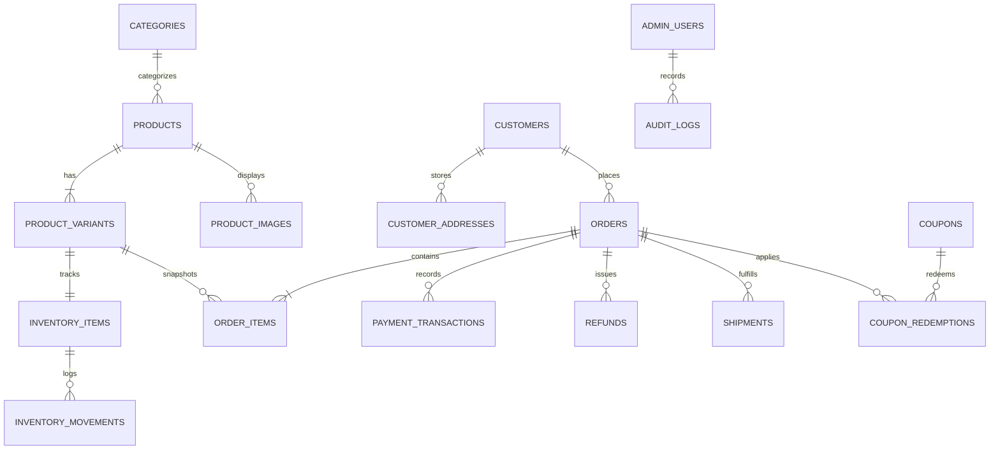

# Database Schema, Security Model & Reporting Formulas

**System:** Rass by Riddhima E-Commerce Operations Platform  
**Database:** PostgreSQL 15+ (Supabase)  
**Security Framework:** PostgreSQL Row Level Security (RLS) + Supabase Auth  
**Author:** Antigravity AI Engineering  
**Version:** 1.0.0 (Phase 2 Specification)

---

## 1. Entity Relationship Overview

The schema is normalized for high data integrity, strict auditability, atomic inventory reservation, and immutable financial history.



---

## 2. Table Specifications & Data Dictionaries

### 2.1 `categories`
Stores product categories and navigational metadata.
```sql
CREATE TABLE categories (
    id TEXT PRIMARY KEY,                       -- e.g. 'rings', 'jhumka', 'necklaces'
    name TEXT NOT NULL,                        -- e.g. 'Rings', 'Dome Jhumka'
    slug TEXT NOT NULL UNIQUE,                 -- e.g. 'rings'
    description TEXT,
    display_order INT DEFAULT 0,
    is_active BOOLEAN DEFAULT TRUE,
    created_at TIMESTAMPTZ DEFAULT NOW(),
    updated_at TIMESTAMPTZ DEFAULT NOW()
);
```

### 2.2 `products`
Core product catalog entities. Historical orders never link directly to mutable product records without an immutable snapshot.
```sql
CREATE TABLE products (
    id TEXT PRIMARY KEY,                       -- e.g. 'rass-ring-01'
    category_id TEXT NOT NULL REFERENCES categories(id) ON UPDATE CASCADE,
    title TEXT NOT NULL,
    slug TEXT NOT NULL UNIQUE,
    short_description TEXT,
    long_description TEXT,
    base_price NUMERIC(12, 2) NOT NULL CHECK (base_price >= 0),
    compare_at_price NUMERIC(12, 2) CHECK (compare_at_price IS NULL OR compare_at_price >= base_price),
    cost_price NUMERIC(12, 2) CHECK (cost_price IS NULL OR cost_price >= 0),
    metal_type TEXT NOT NULL,                  -- e.g. '18k Gold Vermeil', 'Solid 925 Silver'
    gemstones TEXT,                            -- e.g. 'Zambian Emerald & Freshwater Pearls'
    dimensions TEXT,
    weight_grams NUMERIC(8, 2),
    details JSONB DEFAULT '[]'::jsonb,         -- bulleted craft details
    status TEXT NOT NULL DEFAULT 'published'   -- 'draft', 'published', 'archived', 'inactive'
        CHECK (status IN ('draft', 'published', 'archived', 'inactive')),
    is_bestseller BOOLEAN DEFAULT FALSE,
    is_new BOOLEAN DEFAULT FALSE,
    archived_at TIMESTAMPTZ,
    created_at TIMESTAMPTZ DEFAULT NOW(),
    updated_at TIMESTAMPTZ DEFAULT NOW()
);

CREATE INDEX idx_products_category ON products(category_id);
CREATE INDEX idx_products_status ON products(status);
CREATE INDEX idx_products_slug ON products(slug);
```

### 2.3 `product_variants`
Enables sizing, metal finishes, or custom dimensions while maintaining unique SKUs.
```sql
CREATE TABLE product_variants (
    id TEXT PRIMARY KEY,                       -- e.g. 'rass-ring-01-size-12'
    product_id TEXT NOT NULL REFERENCES products(id) ON DELETE CASCADE,
    sku TEXT NOT NULL UNIQUE,                  -- e.g. 'RASS-RNG-01-SZ12'
    variant_name TEXT NOT NULL,                -- e.g. 'Size 12', 'Size 2.6', 'Standard'
    option_type TEXT DEFAULT 'Size',           -- 'Size', 'Metal', 'Finish'
    option_value TEXT NOT NULL,                -- '12', '2.6', '18K Vermeil'
    price_override NUMERIC(12, 2),            -- optional variant specific price
    weight_override_grams NUMERIC(8, 2),
    is_active BOOLEAN DEFAULT TRUE,
    created_at TIMESTAMPTZ DEFAULT NOW(),
    updated_at TIMESTAMPTZ DEFAULT NOW()
);

CREATE INDEX idx_variants_product ON product_variants(product_id);
CREATE INDEX idx_variants_sku ON product_variants(sku);
```

### 2.4 `product_images`
Supports image ordering, clean cutouts, and primary image flags.
```sql
CREATE TABLE product_images (
    id UUID PRIMARY KEY DEFAULT gen_random_uuid(),
    product_id TEXT NOT NULL REFERENCES products(id) ON DELETE CASCADE,
    image_url TEXT NOT NULL,
    clean_image_url TEXT,
    alt_text TEXT,
    display_order INT DEFAULT 0,
    is_primary BOOLEAN DEFAULT FALSE,
    created_at TIMESTAMPTZ DEFAULT NOW()
);

CREATE INDEX idx_images_product ON product_images(product_id);
```

### 2.5 `inventory_items`
Tracks real-time stock levels, reservations, and low-stock triggers.
```sql
CREATE TABLE inventory_items (
    id UUID PRIMARY KEY DEFAULT gen_random_uuid(),
    variant_id TEXT NOT NULL UNIQUE REFERENCES product_variants(id) ON DELETE RESTRICT,
    quantity_on_hand INT NOT NULL DEFAULT 0 CHECK (quantity_on_hand >= 0),
    quantity_reserved INT NOT NULL DEFAULT 0 CHECK (quantity_reserved >= 0),
    low_stock_threshold INT NOT NULL DEFAULT 3 CHECK (low_stock_threshold >= 0),
    updated_at TIMESTAMPTZ DEFAULT NOW()
);

-- Generated or computed available quantity: (quantity_on_hand - quantity_reserved)
```

### 2.6 `inventory_movements`
Immutable ledger of all stock mutations to satisfy business audit requirements.
```sql
CREATE TABLE inventory_movements (
    id UUID PRIMARY KEY DEFAULT gen_random_uuid(),
    inventory_item_id UUID NOT NULL REFERENCES inventory_items(id) ON DELETE RESTRICT,
    movement_type TEXT NOT NULL 
        CHECK (movement_type IN ('purchase_receipt', 'order_reservation', 'order_deduction', 'order_restock', 'manual_adjustment', 'damaged', 'audit_variance')),
    quantity_change INT NOT NULL,              -- positive or negative integer
    quantity_after INT NOT NULL,               -- balance after change
    reference_id TEXT,                         -- order_id, purchase_order_no, or RMA no
    notes TEXT,                                -- reason for manual adjustment
    created_by TEXT DEFAULT 'system',          -- user ID or 'system'
    created_at TIMESTAMPTZ DEFAULT NOW()
);

CREATE INDEX idx_movements_item ON inventory_movements(inventory_item_id);
CREATE INDEX idx_movements_reference ON inventory_movements(reference_id);
```

### 2.7 `customers` & `customer_addresses`
Normalized patron profiles and delivery records.
```sql
CREATE TABLE customers (
    id UUID PRIMARY KEY DEFAULT gen_random_uuid(),
    full_name TEXT NOT NULL,
    email TEXT NOT NULL UNIQUE,
    phone TEXT NOT NULL,
    notes TEXT,
    total_orders_count INT DEFAULT 0,
    total_spend NUMERIC(12, 2) DEFAULT 0,
    created_at TIMESTAMPTZ DEFAULT NOW(),
    updated_at TIMESTAMPTZ DEFAULT NOW()
);

CREATE TABLE customer_addresses (
    id UUID PRIMARY KEY DEFAULT gen_random_uuid(),
    customer_id UUID NOT NULL REFERENCES customers(id) ON DELETE CASCADE,
    address_line1 TEXT NOT NULL,
    address_line2 TEXT,
    city TEXT NOT NULL,
    state TEXT NOT NULL,
    pincode TEXT NOT NULL,
    country TEXT NOT NULL DEFAULT 'India',
    is_default BOOLEAN DEFAULT FALSE,
    created_at TIMESTAMPTZ DEFAULT NOW()
);

CREATE INDEX idx_customers_email ON customers(email);
CREATE INDEX idx_customers_phone ON customers(phone);
```

### 2.8 `orders` & `order_items`
Order header and immutable snapshot items.
```sql
CREATE TABLE orders (
    id TEXT PRIMARY KEY,                       -- e.g. 'RASS-ORD-841920'
    customer_id UUID REFERENCES customers(id) ON DELETE SET NULL,
    customer_name TEXT NOT NULL,
    customer_email TEXT NOT NULL,
    customer_phone TEXT NOT NULL,
    shipping_address_line1 TEXT NOT NULL,
    shipping_address_line2 TEXT,
    shipping_city TEXT NOT NULL,
    shipping_state TEXT NOT NULL,
    shipping_pincode TEXT NOT NULL,
    shipping_country TEXT NOT NULL DEFAULT 'India',
    
    -- Financial breakdown
    currency TEXT NOT NULL DEFAULT 'INR',
    subtotal NUMERIC(12, 2) NOT NULL CHECK (subtotal >= 0),
    discount_amount NUMERIC(12, 2) NOT NULL DEFAULT 0 CHECK (discount_amount >= 0),
    shipping_fee NUMERIC(12, 2) NOT NULL DEFAULT 0 CHECK (shipping_fee >= 0),
    tax_amount NUMERIC(12, 2) NOT NULL DEFAULT 0 CHECK (tax_amount >= 0),
    total_amount NUMERIC(12, 2) NOT NULL CHECK (total_amount >= 0),
    
    -- Coupons
    applied_coupon_code TEXT,
    
    -- Status Lifecycles
    payment_method TEXT NOT NULL,              -- 'razorpay_prepaid', 'cod'
    payment_status TEXT NOT NULL DEFAULT 'pending'
        CHECK (payment_status IN ('pending', 'authorized', 'captured', 'failed', 'refunded', 'partially_refunded')),
    fulfilment_status TEXT NOT NULL DEFAULT 'unfulfilled'
        CHECK (fulfilment_status IN ('unfulfilled', 'processing', 'ready_to_ship', 'shipped', 'delivered', 'cancelled', 'returned')),
    
    -- Razorpay identifiers
    razorpay_order_id TEXT UNIQUE,
    razorpay_payment_id TEXT,
    razorpay_signature TEXT,
    
    -- Internal notes
    admin_notes TEXT,
    cancelled_reason TEXT,
    cancelled_at TIMESTAMPTZ,
    created_at TIMESTAMPTZ DEFAULT NOW(),
    updated_at TIMESTAMPTZ DEFAULT NOW()
);

CREATE TABLE order_items (
    id UUID PRIMARY KEY DEFAULT gen_random_uuid(),
    order_id TEXT NOT NULL REFERENCES orders(id) ON DELETE CASCADE,
    product_variant_id TEXT REFERENCES product_variants(id) ON DELETE SET NULL,
    
    -- Immutable historical snapshot
    product_id_snapshot TEXT NOT NULL,
    product_title_snapshot TEXT NOT NULL,
    variant_name_snapshot TEXT NOT NULL,
    sku_snapshot TEXT NOT NULL,
    image_url_snapshot TEXT,
    unit_price NUMERIC(12, 2) NOT NULL CHECK (unit_price >= 0),
    quantity INT NOT NULL CHECK (quantity > 0),
    line_subtotal NUMERIC(12, 2) NOT NULL CHECK (line_subtotal >= 0),
    created_at TIMESTAMPTZ DEFAULT NOW()
);

CREATE INDEX idx_orders_customer ON orders(customer_id);
CREATE INDEX idx_orders_payment_status ON orders(payment_status);
CREATE INDEX idx_orders_fulfilment_status ON orders(fulfilment_status);
CREATE INDEX idx_orders_created_at ON orders(created_at);
CREATE INDEX idx_order_items_order ON order_items(order_id);
```

### 2.9 `payment_transactions` & `refunds`
Idempotent payment records and refund events.
```sql
CREATE TABLE payment_transactions (
    id UUID PRIMARY KEY DEFAULT gen_random_uuid(),
    order_id TEXT NOT NULL REFERENCES orders(id) ON DELETE CASCADE,
    gateway TEXT NOT NULL DEFAULT 'razorpay',   -- 'razorpay', 'cod_cash'
    gateway_order_id TEXT,
    gateway_payment_id TEXT UNIQUE,
    amount NUMERIC(12, 2) NOT NULL,
    currency TEXT DEFAULT 'INR',
    status TEXT NOT NULL                       -- 'success', 'failed', 'pending', 'refunded'
        CHECK (status IN ('success', 'failed', 'pending', 'refunded')),
    error_code TEXT,
    error_description TEXT,
    raw_payload JSONB,
    created_at TIMESTAMPTZ DEFAULT NOW()
);

CREATE TABLE refunds (
    id UUID PRIMARY KEY DEFAULT gen_random_uuid(),
    order_id TEXT NOT NULL REFERENCES orders(id) ON DELETE CASCADE,
    payment_transaction_id UUID REFERENCES payment_transactions(id),
    amount NUMERIC(12, 2) NOT NULL CHECK (amount > 0),
    reason TEXT NOT NULL,
    gateway_refund_id TEXT UNIQUE,
    status TEXT NOT NULL DEFAULT 'processed' CHECK (status IN ('pending', 'processed', 'failed')),
    created_by TEXT DEFAULT 'admin',
    created_at TIMESTAMPTZ DEFAULT NOW()
);
```

### 2.10 `coupons` & `coupon_redemptions`
Discount logic with server verification and per-customer limits.
```sql
CREATE TABLE coupons (
    id UUID PRIMARY KEY DEFAULT gen_random_uuid(),
    code TEXT NOT NULL UNIQUE,                 -- e.g. 'RASS20', 'WELCOME10'
    discount_type TEXT NOT NULL CHECK (discount_type IN ('percentage', 'fixed_amount')),
    discount_value NUMERIC(10, 2) NOT NULL CHECK (discount_value > 0),
    min_order_value NUMERIC(12, 2) DEFAULT 0,
    max_discount_cap NUMERIC(12, 2),          -- max cap for percentage discounts
    start_date TIMESTAMPTZ DEFAULT NOW(),
    expiry_date TIMESTAMPTZ,
    max_redemptions INT,                       -- global usage limit
    redemption_count INT DEFAULT 0,
    max_per_customer INT DEFAULT 1,
    is_active BOOLEAN DEFAULT TRUE,
    created_at TIMESTAMPTZ DEFAULT NOW(),
    updated_at TIMESTAMPTZ DEFAULT NOW()
);

CREATE TABLE coupon_redemptions (
    id UUID PRIMARY KEY DEFAULT gen_random_uuid(),
    coupon_id UUID NOT NULL REFERENCES coupons(id) ON DELETE RESTRICT,
    order_id TEXT NOT NULL REFERENCES orders(id) ON DELETE CASCADE,
    customer_email TEXT NOT NULL,
    discount_applied NUMERIC(12, 2) NOT NULL,
    redeemed_at TIMESTAMPTZ DEFAULT NOW()
);

CREATE INDEX idx_redemptions_coupon ON coupon_redemptions(coupon_id);
CREATE INDEX idx_redemptions_email ON coupon_redemptions(customer_email);
```

### 2.11 `shipments`
Courier integration tracking (Shiprocket / Delhivery compliant).
```sql
CREATE TABLE shipments (
    id UUID PRIMARY KEY DEFAULT gen_random_uuid(),
    order_id TEXT NOT NULL REFERENCES orders(id) ON DELETE CASCADE,
    courier_partner TEXT NOT NULL,             -- 'Shiprocket', 'Delhivery', 'BlueDart', 'Self'
    awb_number TEXT UNIQUE,                    -- authentic Air Waybill
    shipment_id_external TEXT,
    label_url TEXT,                            -- genuine shipping label PDF URL
    manifest_id TEXT,
    shipping_status TEXT NOT NULL DEFAULT 'manifested'
        CHECK (shipping_status IN ('manifested', 'pickup_scheduled', 'in_transit', 'out_for_delivery', 'delivered', 'rto', 'cancelled')),
    tracking_url TEXT,
    shipped_at TIMESTAMPTZ,
    delivered_at TIMESTAMPTZ,
    created_at TIMESTAMPTZ DEFAULT NOW(),
    updated_at TIMESTAMPTZ DEFAULT NOW()
);

CREATE INDEX idx_shipments_order ON shipments(order_id);
CREATE INDEX idx_shipments_awb ON shipments(awb_number);
```

### 2.12 `webhook_events` & `audit_logs`
Guarantees idempotent webhook processing and administrative accountability.
```sql
CREATE TABLE webhook_events (
    id UUID PRIMARY KEY DEFAULT gen_random_uuid(),
    event_id TEXT NOT NULL UNIQUE,             -- e.g. Razorpay event ID
    source TEXT NOT NULL,                      -- 'razorpay', 'shiprocket'
    event_type TEXT NOT NULL,                  -- 'payment.captured', 'order.paid'
    payload JSONB NOT NULL,
    processed_status TEXT NOT NULL DEFAULT 'processed'
        CHECK (processed_status IN ('processed', 'failed', 'ignored')),
    error_message TEXT,
    created_at TIMESTAMPTZ DEFAULT NOW()
);

CREATE TABLE audit_logs (
    id UUID PRIMARY KEY DEFAULT gen_random_uuid(),
    user_email TEXT NOT NULL,
    action TEXT NOT NULL,                      -- 'update_stock', 'cancel_order', 'create_coupon'
    entity_type TEXT NOT NULL,                 -- 'product', 'inventory', 'order', 'coupon'
    entity_id TEXT NOT NULL,
    changes JSONB,
    created_at TIMESTAMPTZ DEFAULT NOW()
);
```

---

## 3. Security Model & Row Level Security (RLS)

### 3.1 Roles
1. `anon`: Public visitors and storefront shoppers.
2. `authenticated`: Logged-in patrons.
3. `admin` / `service_role`: Privileged administrative operations.

### 3.2 Access Policies Summary
- **`products` & `categories`:**
  - `anon` / `authenticated`: `SELECT` where `status = 'published'`.
  - `admin`: Full `SELECT`, `INSERT`, `UPDATE`, `DELETE`.
- **`inventory_items` & `inventory_movements`:**
  - `anon`: No direct table access. (Available inventory queried via atomic view or RPC).
  - `admin`: Full `SELECT`, `INSERT`, `UPDATE`.
- **`orders` & `order_items`:**
  - `anon`: Can `INSERT` during checkout via secure RPC / Edge Function.
  - `authenticated`: Can `SELECT` their own orders where `customer_email = auth.jwt() ->> 'email'`.
  - `admin`: Full `SELECT`, `UPDATE` (status changes, admin notes).
- **`coupons`:**
  - `anon`: Read-only verification query on active coupons.
  - `admin`: Full CRUD.
- **`audit_logs` & `payment_transactions` & `webhook_events`:**
  - `anon`: No access.
  - `admin`: Read access for ledger audits.

### 3.3 Serverless Privileged Boundaries
- Razorpay Key Secret (`RAZORPAY_KEY_SECRET`), Resend API Key (`RESEND_API_KEY`), and Shiprocket Credentials **MUST NEVER** be placed in client-side `.env` or Vite bundles.
- All payment creation and signature verification must occur in serverless endpoints (`/api/razorpay/...` or Supabase Edge Functions).

---

## 4. Financial & Reporting Formulas

All dashboard analytics and order ledger figures strictly adhere to the following codified accounting principles:

### 4.1 Sales Definitions
1. **Gross Merchandise Sales (GMS):**
   $$\text{Gross Sales} = \sum (\text{item\_price\_at\_purchase} \times \text{quantity})$$
   *The total face value of jewellery items ordered before any discounts, shipping, or taxes.*

2. **Applied Discounts:**
   $$\text{Discounts} = \sum (\text{coupon\_discount} + \text{promotional\_markdown})$$

3. **Refunds & Returns:**
   $$\text{Refunds} = \sum (\text{processed\_refund\_amount})$$
   *Only completed/processed refunds are deducted.*

4. **Net Merchandise Sales:**
   $$\text{Net Sales} = \text{Gross Merchandise Sales} - \text{Discounts} - \text{Refunds}$$
   *Crucial distinction: Shipping charges and GST/taxes are treated as pass-throughs and not conflated with net merchandise sales.*

5. **Total Order Inflow (Gross Collected Cash):**
   $$\text{Total Inflow} = \text{Net Sales} + \text{Shipping Collected} + \text{Tax Collected}$$

6. **Average Order Value (AOV):**
   $$\text{AOV} = \frac{\text{Net Merchandise Sales}}{\text{Count of Recognized Paid Orders}}$$

7. **COD Orders vs Prepaid Ratio:**
   $$\text{Prepaid \%} = \frac{\text{Count of Prepaid Orders}}{\text{Total Orders}} \times 100$$
   $$\text{Pending COD Collection} = \sum (\text{total\_amount of uncollected COD orders})$$

### 4.2 Exclusion Rules
- Orders with `payment_status = 'failed'` or `fulfilment_status = 'cancelled'` prior to capture are strictly **excluded** from Net Sales and Gross Sales metrics.
- Discontinued or archived products retain their historical sales contribution indefinitely.
